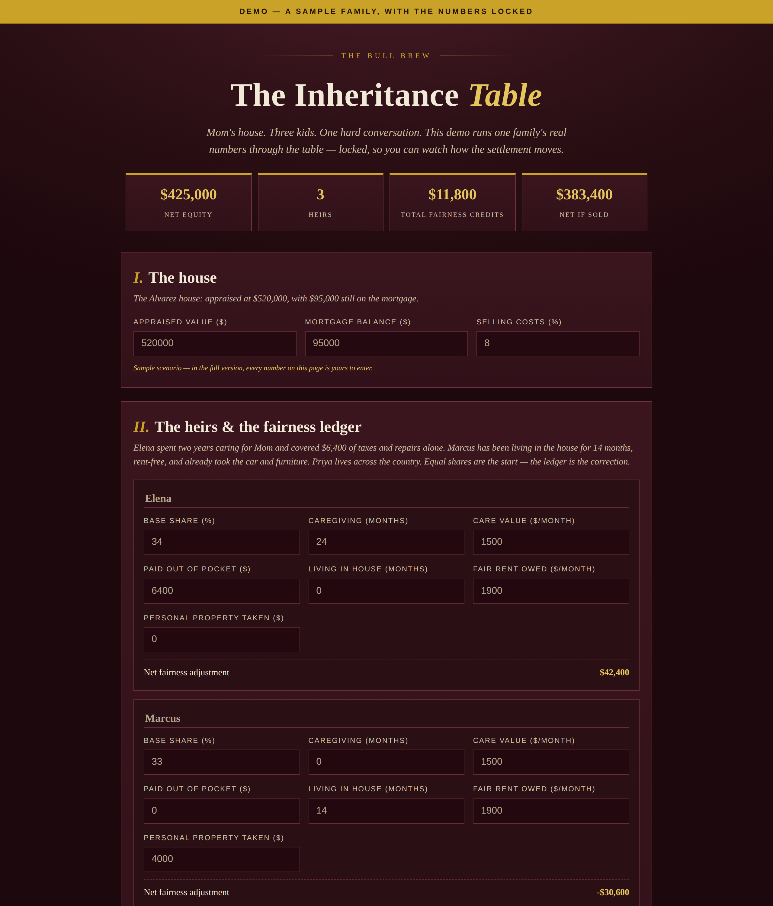

# The Inheritance Table — Demo

**Live demo:** https://thebullbrew.github.io/inheritance-table-demo/

A locked, read-only demo of **The Inheritance Table** — the paid tool that settles an inherited house between siblings without a fight. One sample family (the Alvarezes: a $520,000 house, three siblings, two years of caregiving, and one brother living in the house rent-free) runs through the full fairness ledger so you can watch the settlement move.

## What the demo shows

- The fairness ledger in action: a **+$42,400** caregiving/out-of-pocket credit for Elena, a **−$30,600** occupancy and personal-property charge for Marcus, and a clean $0 for Priya.
- All three settlement paths, fully computed: Elena's buyout if she keeps the house, the sell-and-split proceeds, and the rent-and-split monthly income with credits settling out of the first months of rent.
- The "who owes whom" summary in plain words — the part families read out loud.

## What the demo locks

Everything. The sample numbers can't be edited, nothing is saved, and there's no print or export. The full version — your own house, unlimited heirs, every credit adjustable, and a printable settlement summary — is sold at [thebullbrew.com](https://www.thebullbrew.com).

## How to run

Open `docs/index.html` in any browser, or use the live link above. Static, client-side, installable as a PWA.
